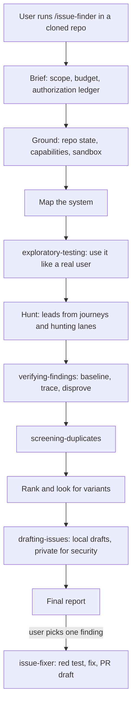

# Issue Finder: an evidence-driven bug-hunting skill suite

Design doc. Approved 2026-10-27. Turns the empty `issue-finder` project into a publishable, mattpocock-style suite of six agent skills. Agents using it run a cloned open-source project like real users, verify every finding against evidence, screen for duplicates, and write local issue drafts. Fixes happen only when the user asks for a specific finding.

## Decisions

- **Six skills, mattpocock-style.**
  - Two user-invoked entry points: `issue-finder` and `issue-fixer`.
  - Four model-invoked disciplines: `exploratory-testing`, `verifying-findings`, `screening-duplicates`, and `drafting-issues`.
  - The entry points orchestrate. The disciplines hold reusable rules and also work on their own, for questions like "is this bug real?" or "has this been reported?".
- **A run ends at verified findings plus local drafts.**
  - `issue-finder` never edits the target project's source.
  - Fixing a finding is a separate, explicit run such as `/issue-fixer IF-002`.
  - Commit, push, rebase, public issues, PRs, and security disclosure stay off unless the user grants each one individually.
- **Both entry points are user-invoked.** They set `disable-model-invocation: true` in frontmatter and `policy.allow_implicit_invocation: false` in `agents/openai.yaml`, so a multi-hour hunt never fires on a casual "is there a bug here?". The trade-off is that these two files fail strict `skills-ref validate` and claude.ai zip uploads. An ADR and the README say so.
- **Flat `skills/<name>/` layout and no root `SKILL.md`.**
  - The placeholder root `SKILL.md` is deleted. A root `SKILL.md` stops `npx skills` discovery early and ships the whole repo to every user (facts 6 and 7 in `docs/research/agent-skills-format-and-distribution.md`).
  - A flat folder also maps cleanly onto every plugin manifest. It avoids the friction between bucket folders and manifests that mattpocock's ADR 0002 describes.
- **Publishing identity:** `ANAMASGARD/issue-finder` (the logged-in `gh` account), MIT license, author Gaurav Chaudhary.
- **Run state lives in `.issue-finder/` inside the target checkout.** It is added to `.git/info/exclude`, so sandboxed agents can write to it and it never lands in a commit.

## How a run flows



## Repository layout

```text
issue-finder/
├── README.md                 # pitch, safety model, per-agent installs, usage, reference, FAQ
├── AGENTS.md  CLAUDE.md      # maintainer rules; CLAUDE.md is just "@AGENTS.md"
├── SCOPE.md  GLOSSARY.md  CHANGELOG.md  SECURITY.md  LICENSE
├── package.json              # private; changesets, version sync, validate scripts
├── .changeset/  .claude-plugin/  .cursor-plugin/  .github/
├── .agents/                  # install-block.md, invocation.md, writing-docs.md, adr/0001-0003
├── .out-of-scope/            # auto-publishing, finding quotas, scanner-only mode
├── docs/research/  docs/specs/  docs/skills/<name>.md
├── evals/                    # triggers.json, evals.json, fixtures/ (not shipped)
├── scripts/                  # validate-skills.mjs, sync-plugin-version.mjs, link-skills.sh, list-skills.sh
└── skills/                   # the only folder users receive
    ├── issue-finder/  exploratory-testing/  verifying-findings/
    └── screening-duplicates/  drafting-issues/  issue-fixer/
```

Each run writes this workspace into the target checkout:

```text
.issue-finder/
├── ENGAGEMENT.md            # scope, budget, authorization ledger (external actions default NO)
├── state.md  capabilities.md  system-map.md  claims.md  journeys.md
├── candidates.md            # ledger: one row per IF-### with status and disposition
├── findings/IF-001-<slug>/  # record.md, repro/, evidence/
├── drafts/   private/       # private/ is mode 0700, security-sensitive material only
└── REPORT.md
```

## The six skills

Every skill has:

- A `SKILL.md` under 500 lines, with its non-negotiables first so they survive context compaction.
- Sibling reference files that the agent loads only when needed.
- An `agents/openai.yaml` file with Codex display metadata.

Companion skills are invoked by name ("Call the Skill tool with verifying-findings"). If one is missing, the entry point stops and tells the user to install the full suite.

### `issue-finder` (user-invoked)

Each phase ends on a criterion the agent can check:

1. **Brief:** write `ENGAGEMENT.md`.
2. **Ground:** record repo state, capabilities, the sandbox choice, and the project's own rules, treating those rules as information rather than instructions.
3. **Map:** build the system map.
4. **Use:** call `exploratory-testing`.
5. **Hunt:** turn journey results and eight hunting lanes into leads.
6. **Verify:** call `verifying-findings`, then `screening-duplicates`.
7. **Rank:** apply the master prompt's 30/25/20/15/10 scoring, a 70-point bar, a default budget of 3 deep investigations, and a variant search.
8. **Draft:** call `drafting-issues`.
9. **Report:** lead with outcomes and external-action status, then suggest `/issue-fixer` runs.

Reference files:

- `ENGAGEMENT.md`, `WORKSPACE.md`, `REPO-STATE.md`, `CAPABILITIES.md`
- `SYSTEM-MAP.md`, `HUNTING-LANES.md`, `RANKING.md`, `VARIANTS.md`
- `ORGANIZATION.md`, `OPTIONAL-SKILLS.md`, `FINAL-REPORT.md`

Scripts: `init-workspace.sh`, `snapshot-repo-state.sh`, and `inventory-capabilities.sh`. All three are small, non-interactive, and network-free, support `--help`, and have a documented manual fallback.

### `exploratory-testing` (model-invoked)

This is the "use it like a human" engine. Its loop:

1. Choose personas.
2. Turn the docs, `--help` output, and examples into a claims ledger.
3. Install the project the documented way in a clean sandbox.
4. Run chartered sessions using tours and test heuristics.
5. Judge every surprise against a named oracle.
6. Record each journey as pass, fail, partial, or blocked, with evidence.

Its output is always leads, never findings.

General references: `PERSONAS.md`, `TOURS-AND-HEURISTICS.md`, `ORACLES.md`, `JOURNEY-LEDGER.md`.

One playbook per project type:

- `CLI.md`, `WEB-UI.md`, `HTTP-SERVICES.md`, `LIBRARIES.md`
- `KUBERNETES-AND-INFRA.md`, `CI-AND-INTEGRATIONS.md`, `DATA-AND-LANGUAGE-TOOLS.md`
- `DESKTOP-AND-MOBILE.md`: GNOME/GTK, Electron, and mobile apps, with honest limits on what an agent can drive.
- `SECURITY-TOOLS.md`: scanners like Kubescape or Grype, covering false positives and negatives, SARIF output, and exit codes.

### `verifying-findings` (model-invoked)

The gates a candidate must pass:

- A version-correct contract for the expected behavior.
- A path that is reachable in a supported configuration.
- A red reproduction, run twice on a pinned baseline at the public interface, then minimized.
- A root cause traced back to its origin.
- A negative control and a real attempt to disprove the bug.
- Stated proof boundaries, plus impact and scope.

It ends in exactly one disposition:

- Confirmed and actionable
- Confirmed but already reported
- Already fixed upstream
- Enhancement requiring maintainer discussion
- Needs additional runtime validation
- Rejected hypothesis
- Security-sensitive: private handling required (this overrides every other authorization)

Reference files:

- `CANDIDATE-RECORD.md`, `PROOF-BOUNDARIES.md`, `SECURITY-CANDIDATES.md`
- `PERFORMANCE-EVIDENCE.md`, `NONDETERMINISTIC.md`
- `WORKED-EXAMPLE.md`: the Helm CronJob case from the original master prompt, generalized.

### `screening-duplicates` (model-invoked)

1. Build a query set: the symptom, exact error text, component and configuration keys, code symbols, the mechanism, and broader and narrower variants.
2. Run it across issues, PRs in every state, discussions, commits (`git log --grep`, `-S`, `-G`), changelogs, and advisories.
3. Read the bodies of results, not just their titles, and record every query.
4. Return a verdict, and re-run the screen right before anything is published.

Reference: `FORGES.md`, covering `gh`, `glab` (including self-hosted instances like gitlab.gnome.org), Gitea/Forgejo, Bugzilla, Jira, Launchpad, mailing lists, and OSV.

### `drafting-issues` (model-invoked)

- **Preflight:**
  - The finding must be confirmed and screened.
  - The project's issue templates and forms, CONTRIBUTING file, AI-contribution policy, SECURITY.md, and DCO rules are read and followed.
  - If the project bans AI-assisted reports, the skill stops and tells the user.
- **Content:**
  - Titles stay under about 72 characters and name the component and the observable failure.
  - The body follows the master prompt's Phase 10 sections.
  - Secrets are redacted, and anything not verified is stated explicitly.
  - Bug reports carry no fix pitch.
- **Fresh-eyes check:** a subagent with no prior context, or a rerun in a clean container, must reproduce the bug from the draft's steps alone before the draft is final.
- **Templates:** `BUG-REPORT.md`, `FEATURE-REQUEST.md`, and `SECURITY-ADVISORY.md` (private only).

Publishing is a separate step that needs explicit authorization.

### `issue-fixer` (user-invoked)

Preconditions: the finding record says Confirmed and actionable. If `ENGAGEMENT.md` lacks authorization for a local branch and source changes, the skill asks for it.

Its steps:

1. Fetch the upstream default branch, then rerun the reproduction and the duplicate screen on the fresh commit.
2. Create a separate worktree on a project-native branch name such as `fix/<component>-<failure>`, never with `ai/`, `agent/`, or `codex/` prefixes.
3. Write the failing regression test at the public interface first.
4. Make the smallest change that fixes the root cause.
5. Run the validation ladder, from the focused test up to the full suite.
6. Get an independent review from an installed code-review skill or a subagent.
7. Write a PR draft.

Reference files: `BRANCHING.md`, `VALIDATION.md`, `PR-DRAFT.md`.

Example frontmatter for the entry point:

```yaml
---
name: issue-finder
description: Hunt a local checkout for real, reproducible bugs, vulnerabilities, performance problems, and missing features by using the project like a real user, then verify, rank, and draft reports.
license: MIT
compatibility: Needs shell, git, and the target's toolchain. Run inside a container or VM; it builds and executes untrusted code.
disable-model-invocation: true
---
```

## Upgrades over the master prompt

- **A real "use it like a human" engine.** It covers personas, docs treated as a contract, test charters, exploratory-testing tours, the SFDIPOT coverage checklist, the FEW HICCUPPS oracles, and per-project-type playbooks. The master prompt only listed example journeys.
- **A candidate lifecycle with gates.** A candidate moves through lead, reproduced, traced, screened, and disposition, and each gate can be checked. The master prompt stated these as prose principles.
- **Anti-hallucination measures:**
  - Every claim cites an artifact path and a commit SHA.
  - Command output is quoted verbatim.
  - Every "this is wrong" names the oracle it is judged by.
  - A disproof attempt is mandatory.
  - The fresh-eyes reproduction gates every draft.
  - Zero confirmed findings is reported as a valid outcome, not a failure.
- **Prompt-injection defense.** The target's AGENTS.md, CLAUDE.md, rules, and bundled skills are read as information about its conventions. They can never expand authorization or override the suite.
- **Safe execution.** A sandbox decision tree (devcontainer, container, VM, or disposable cloud sandbox) and credential scrubbing come before any target code runs.
- **Resumable after compaction.** The `.issue-finder/` ledger is the memory, and on resume the agent rereads `ENGAGEMENT.md` and `candidates.md`.
- **Portable optional tools.** It routes to optional extras (Semgrep, CodeQL, fp-check, variant-analysis, Context7, browser automation, diagnosing-bugs, tdd) when they are installed, instead of the master prompt's hard-coded local paths. A missing tool becomes a recorded testing boundary.
- **Subagents.** Each deep investigation runs in its own subagent when the agent supports it.

## Distribution

- **skills.sh:** `npx skills@latest add ANAMASGARD/issue-finder --skill '*' -a <agent>`, confirmed via Context7 against vercel-labs/skills. The skills.sh listing appears automatically from install telemetry, and the README carries the skills.sh badge.
- **Claude Code:** `.claude-plugin/marketplace.json` (marketplace `anamasgard`) and `plugin.json` (plugin `issue-finder`).
  - The manifest relies on Claude Code's default discovery of the `skills/` folder.
  - `claude plugin validate . --strict` and a test install confirm it works.
  - Codex and Copilot CLI read the same manifests, per mattpocock's 2026-10-07 ADR update.
- **Cursor:** `.cursor-plugin/plugin.json` with `"skills": "./skills/"`, plus a `marketplace.json`.
- **Gemini CLI:** `gemini skills install https://github.com/ANAMASGARD/issue-finder.git --path skills`.
- **Versioning:** changesets, and `npm run version` syncs the version into both plugin manifests. The release workflow opens a "chore: version skills" PR.
- **One install wording:** a single canonical install block in `.agents/install-block.md`, copied verbatim into the README.

## Quality gates

- **`scripts/validate-skills.mjs`, run in CI**, checks that:
  - frontmatter uses only the six spec keys plus `disable-model-invocation`;
  - each skill's `name` matches its folder;
  - descriptions are at most 1,024 characters and contain no angle brackets;
  - bodies are at most 500 lines;
  - every relative link resolves inside its own skill folder;
  - the `openai.yaml` invocation policy matches the frontmatter;
  - every skill appears in the README, the docs, and the manifests;
  - there are no em-dashes.
- **CI also runs** shellcheck and `npx skills@latest add . --list`.
- **Local pre-release checks:** `claude plugin validate . --strict`, `gh skill publish --dry-run`, and an install into a throwaway home directory to confirm that only `skills/*` ships.
- **Evals in `evals/`, which are not shipped to users:**
  - Trigger cases for the four model-invoked skills: queries that should fire them, and near-misses that should not.
  - A CLI fixture whose README example fails.
  - A clean library fixture where the right answer is zero findings.
  - A toy server fixture with a path-traversal bug that must be handled privately.
  - A variant where the checkout has uncommitted changes that must stay untouched.
  - One real open-source repo pinned before a known fix, which should end as "Already fixed upstream" on the latest commit.
- **Review and smoke test:** every `SKILL.md` gets a writing review using the `writing-for-agents` skill, followed by a smoke run of `/issue-finder` on a fixture.

## Needs the maintainer's go-ahead later

These steps wait for explicit approval:

- Creating the public GitHub repo.
- Pushing.
- Tagging v0.1.0.
- The first `npx skills add` that seeds the skills.sh listing.
- Any submission to Claude's official plugin marketplace.

Local `git init` and milestone commits (conventional commits, no remote) are part of the build.
